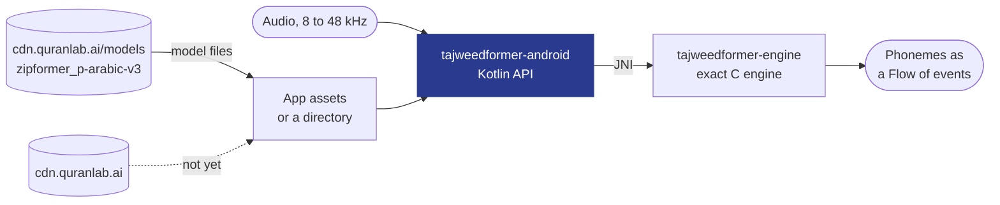

# TajweedFormer for Android: reference for coding assistants

Everything an assistant needs to integrate this SDK correctly: use only the names, calls and settings shown here or in the installed version's sources. People: the short version is in [README.md](README.md).

## What you get

<table>
<tr>
<td width="33%" valign="top">

**Hears every word**<br>Streaming recognition of Quranic recitation while the learner recites. Results arrive as often as every 160 ms on the CPU engine (320 ms by default, including on the NPU; 480 ms for longer context).

</td>
<td width="33%" valign="top">

**Points to the word to fix**<br>Wrong letters and vowels, madd held too short or too long, and a score for every word. Qalqalah checks are experimental.

</td>
<td width="33%" valign="top">

**Native on Android**<br>Kotlin for Android 8.0+ and the desktop JVM. It runs on the CPU on every phone, and on the NPU where this phone's build passes its self-test.

</td>
</tr>
<tr>
<td valign="top">

**Private by default**<br>Offline, on the device. A recording leaves it only when the learner agrees to share it.

</td>
<td valign="top">

**Nothing to host**<br>The SDK downloads the right model for each device (about 57 MB) from our CDN in six regions, verifies it and keeps it up to date.

</td>
<td valign="top">

**Tuned in the portal**<br>Four presets and three word levels. Change them at any time; your app picks them up without a new build.

</td>
</tr>
</table>

### Strict or gentle: you choose

**Strict** almost never flags a correct recitation. **Balanced** is the default. **Sensitive** catches more, and **Very sensitive** catches the most, for a teacher who reviews every flag first. The word level follows your learners: **strict** for huffaz and advanced students, **general** for most apps, **beginner** for children and classes.

## Why TajweedFormer

- **Made for the Quran.** Your app names the ayah; TajweedFormer checks the recitation against it, sound by sound, and gives every word its own verdict.
- **Feedback in the moment.** Results stream while the learner recites, so your app can respond on the word itself, not after the take.
- **One engine on every platform.** The same engine runs the [Android](https://github.com/Quran-Lab/tajweedformer-android), [iOS and macOS](https://github.com/Quran-Lab/tajweedformer-apple), [web](https://github.com/Quran-Lab/tajweedformer-web) and [Windows and Linux](https://github.com/Quran-Lab/tajweedformer-c) SDKs, all set from one portal.
- **Free, and it stays free.** Quran Lab is a non-profit waqf: the SDKs and models are never sold. The licence, NPL-1.2, asks three things: no paywall on model features, no results presented as rulings, and show the notice.

## Built for AI developers

Copy the setup prompt from [portal.quranlab.ai](https://portal.quranlab.ai) and paste it into your coding assistant. That one prompt sets everything up: the package, your key, and the settings for the learners your app is for. [AGENTS.md](AGENTS.md), beside this README, gives the assistant the complete API, so the code it writes uses names that exist. Prefer to do it by hand? Get a key in the portal and start below.

## At a glance

- **What it is:** the Kotlin SDK 2.0.1 for the Quran Lab TajweedFormer engine (Maven
  `ai.quranlab:tajweedformer`, package `ai.quranlab.tajweedformer`): a JNI bridge over
  [tajweedformer-engine](https://github.com/Quran-Lab/tajweedformer-engine) (pinned as the `engine/`
  submodule) and an API that mirrors the Swift SDK. For the V4 model (`sdk/v4.0`): signed model
  folders downloaded by profile, a `TajweedRecognizer` that streams every head of the network on the
  CPU (or the NPU), the decoded transcript with confidences, and tajweed verdicts per site and per
  word under calibrated presets that the app and the portal can tune. V4 only; v3.2 stays on 1.x.
- **Who it is for:** Android apps (AAR, minSdk 26, arm64-v8a and armeabi-v7a); the same Kotlin
  sources also run on the desktop JVM.
- **Status:** preview. V4 streams through the exact engine (tajweedformer-engine b6436d7,
  `zf_tajweed.h` API 2): 35 of 35 parity clips bit-identical at c16_l64 on all 12 outputs of every
  chunk through this SDK's `TajweedRecognizer`, from a model folder downloaded by `ModelStore` (desktop
  JVM, Windows x86-64, and the Alcatel 1, armeabi-v7a, Android 11). The scorer gives the reference
  scorer's verdicts on all 48 golden clips at both presets. The NPU backend is built and its host side
  tested on the JVM; its native runner ran on the Exynos 2500 and 2600 boards (every head byte-identical
  to the bench runner); the backend has not run inside an app on an NPU phone.

## The TajweedFormer SDKs

One model, one engine, the same bits on every platform. Each SDK compiles the same engine source
(Quran-Lab/tajweedformer-engine, pinned as a submodule), so no platform can drift from the others.

| Repository | What it is | Platforms | Install |
| - | - | - | - |
| [tajweedformer-android](https://github.com/Quran-Lab/tajweedformer-android) | Kotlin SDK (AAR) | Android 8.0+, desktop JVM | Maven `ai.quranlab:tajweedformer:2.0.1` |
| [tajweedformer-apple](https://github.com/Quran-Lab/tajweedformer-apple) | Swift SDK: Neural Engine (CoreML) with the exact CPU engine as fallback | iOS 15+, macOS 12+ | SwiftPM, product `TajweedFormer` |
| [tajweedformer-web](https://github.com/Quran-Lab/tajweedformer-web) | WebAssembly SDK with SIMD128 | Browsers, Node | npm `@quran-lab/tajweedformer` |
| [tajweedformer-c](https://github.com/Quran-Lab/tajweedformer-c) | C API and server runner with x86 int8 kernels (AVX2, AVX-VNNI, AVX-512 VNNI) | Windows, Linux (x86-64) | CMake (`add_subdirectory`) |
| [tajweedformer-engine](https://github.com/Quran-Lab/tajweedformer-engine) | The engine: exact C runtime, tajweed scorer, conformance suite | everything above | Git submodule |

The model is Quran-Lab/tajweedformer-v4 (`sdk/v4.0`), hosted by Quran Lab and served by
`cdn.quranlab.ai/models` to approved app keys (request access at
[portal.quranlab.ai/access](https://portal.quranlab.ai/access)). SDK 2.0.0 runs V4 only.
Every release's binaries (the AAR and POM, the XCFramework zips, the npm package, the native archives) are
also on `https://cdn.quranlab.ai/sdk/<product>/<version>/`, with a `SHA256SUMS` file, served from six regions.
[portal.quranlab.ai](https://portal.quranlab.ai) is where you create an app, get its developer key,
choose which model revision your users get, and set the tajweed checks (presets, per-class
thresholds) your users see, without shipping a new build.

## Quick start

```sh
git clone --recurse-submodules https://github.com/Quran-Lab/tajweedformer-android
cd tajweedformer-android
./gradlew :tajweedformer:assembleRelease     # tajweedformer/build/outputs/aar/tajweedformer-release.aar
```

Depend on `ai.quranlab:tajweedformer:2.0.1` (the AAR, or the `:tajweedformer` project).

### Ten lines

```kotlin
import ai.quranlab.tajweedformer.*
import ai.quranlab.tajweedformer.android.TajweedFormerAndroid

val tf = TajweedFormerAndroid.client(context, headers = { mapOf("x-qlab-key" to BuildConfig.QLAB_KEY) })
val tj = tf.recognizer(TajweedRecognizer.Options(word = WordOption.level(WordLevel.GENERAL)))  // 56.5 MB once, self-test, CPU or NPU
tj.remoteConfig = portalConfig.tajweedJson                  // optional: the portal's tajweed block
val session = tj.startSession()
launch { session.chunks.collect { c -> draw(c.heads, c.decode(tj.model.vocabulary)) } }  // raw + decoded, per 320 ms
session.append(samples)                                     // 16 kHz mono float, as it arrives
val result = session.finishAndScore(surah = 1, ayah = 2)    // tajweed layer: sites, madd, words
result.flaggedWords.forEach { w -> show(w.word, w.score, w.best?.expected, w.best?.alternative) }
```

`tf.recognizer()` downloads the CPU profile on the first call (any network), verifies it, runs the
CPU self-test, and serves on the exact CPU engine. The NPU is promoted in the background after the first
session (download on an unmetered network, load, warm-up, the golden test against the CPU engine) and used
from the next session once it is ready and warm ("CPU first, then the accelerator" below).
`tj.backendChoice` says which backend runs and why.

### The three layers (one concept set with the Swift, web and native SDKs)

- **Raw** (`TajweedChunk.heads`, `TajweedHeads`): every head per chunk as float arrays,
  `[frames, width]` row major, each typed (`TajweedHead.frameMs` 40 or 20, `width`, `kind`
  log-probs / probs / logit, `classNames(vocabulary)`). Opt in per head with
  `Options(heads = setOf(...))` or `allHeads = true`; the default is what the scorer reads plus `conf`.
- **Decoded** (`chunk.decode(vocabulary)`, `tj.decode(heads)`): per 40 ms CTC frame the top-1 and
  runner-up token with log-probs and margin; the greedy transcript with per-token `conf` (sigmoid of
  the conf head over the token's frames), `margin` and a display `confidence`; words split at the
  `|` token; times in ms (frame k = 40 k ms of the take).
- **Tajweed** (`TajweedResult`): per-site verdicts (class, expected, best alternative, per-head and
  fused LLR, threshold, flagged, frames), madd counts with ratio and duration, qalqalah and
  gemination evidence, and per-word verdicts (`words`): the engine's readout (zf_tajweed.h API 3,
  calibration.json `word.readout`), the largest clipped fused LLR over every single-unit edit inside the
  word, flagged when `score >= tau`, with the best edit as evidence. Word levels come from
  calibration.json's per-context `word` block (c16_l64: strict 7.0224, general 5.5368, beginner 3.9759,
  default general, custom 2.0 to 12.0); P2.5's table (strict 6.5, general 4.93, beginner 4.0, floor 2.0)
  is used only without a block, and a site-based approximation only with an engine before API 3.
  Precedence everywhere: app code > portal > calibration.

### Observing the SDK

`TajweedFormer.events.add(observer)` with an `SdkObserver`: session start and end (audio seconds,
compute seconds, RTF, chunks, backend), the audio exactly as pushed (`onAudio`, for opt-in recording
sharing), backend choice and every fallback with a reason code, download progress and results,
self-test results, handled errors. The SDK's cloud module (telemetry, sharing) is built on it; what it
sends to Quran Lab is described in [docs/platform-client.md](docs/platform-client.md) (see
[Recitation sharing](#recitation-sharing) and [Telemetry](#telemetry) below).

## How it works



Each recognizer owns one thread; every engine call it makes runs there, in order. Audio goes to the
engine unchanged through `native/zf_jni.c`, and the engine resamples, computes the fbank, runs the
model one 480 ms chunk at a time and decodes the phonemes. The model download and update services
of the Swift SDK (CDN, signed manifests, staged rollouts from `portal.quranlab.ai`) are not in the
Android SDK yet; apps ship the model files themselves.

<!-- exactness:begin -->
## Exactness

Bit-exact means the same thing in every Quran Lab TajweedFormer repository. For the same input, the
engine gives the same phoneme tokens and the same value, to the last bit, for every log-probability
of every chunk, as ONNX Runtime's ARM int8 reference running the published v3.2 model. It is checked
on the 35 parity clips of the conformance set (the `conformance-data-2` release of tajweedformer-engine):
the tokens, the chunk count and an FNV-1a fingerprint of every chunk's log-probs are compared with
the expected files, and one bit of difference on one clip is a failure. Paths that cannot meet this
(the Neural Engine, NPUs, fp16 anywhere) are called approximate, and they are measured against the
exact engine, never the other way round.
<!-- exactness:end -->

### How this repository proves it

The wrapper adds nothing that could move a bit: it builds the engine in its release configuration
(`ZF_RELEASE`, `ZF_QUANT_DIVIDE`, no floating point contraction), passes samples through unchanged,
and resamples with the engine's own resampler. `V4ConformanceTest` downloads the layout v2 folder
through `ModelStore`, streams the 35 parity clips' 16 kHz audio through `TajweedRecognizer` in 320,
1234, 16000 and 4321-sample pieces at c16_l64, and compares the chunk count, the greedy tokens, the
cumulative FNV-1a of log_probs and the FNV-1a of all 12 outputs of every chunk (7,824 chunk
outputs) with the engine's `v4_c16_l64_audio_expected.jsonl`: 35 of 35 on the desktop JVM, and
35 of 35 on the Alcatel 1, armeabi-v7a, Android 11 (`DeviceEndToEndTest`, after a ModelStore download over adb reverse with a cut and a Range resume). The 1.x history (v3.2 and v3.1 passes) is in
docs/engineering-notes.md.

## Performance

Through this SDK on the Alcatel 1 only a debug native build has run so far (RTF 0.78, not representative). The engine it wraps, at the same source,
measured on Android (from the pinned engine's README):

| Device | Configuration | Per 480 ms chunk | Measured |
| - | - | - | - |
| Alcatel 1 (MT6739, 4x Cortex-A53, armeabi-v7a) | exact engine, ORT-free runner, 4 threads | 78.1 to 79.1 ms, RTF 0.163 to 0.165 | 2026-09-24 |
| Alcatel 1 | exact engine, under ONNX Runtime | 80.8 to 81.2 ms, RTF 0.168 to 0.169 | 2026-09-24 |

Dates are those of the tajweedformer-engine commit that recorded the figure.

## Usage

### Tajweed settings (V4)

Three layers decide what is checked and how strictly, and every SDK resolves them the same way
(the shared settings vectors are this repository's tests):

1. **App code** (`TajweedOptions`): a global `preset`, per-class `overrides` (a preset or a fused-LLR
   threshold in -20..20), `featurePresets` for madd, qalqalah and gemination, `checks` on or off, and
   the `context`. An invalid value throws `RecognizerException.InvalidAppOption` (code
   `invalid_app_option`): app code is never silently dropped.
2. **The portal** (`portal.quranlab.ai`), as the `tajweed` block of the signed `/v1/config`:
   `RemoteTajweed.parseJson` (or `fromConfigJson` for the whole document) never throws; an invalid
   field is dropped and listed in `dropped`, and a block whose `v` is not 1 is ignored whole.
3. **calibration.json** in the model folder: the default context and preset, each class's status
   and thresholds per preset (and per backend, `int8` for the exact engine, `fp32` for CoreML, NPUs
   and servers).

Per class, an override (app, then portal) wins over a global preset (app, then portal), which wins
over calibration's default. Checks follow app, then portal, then calibration's status: `validated`
is on by default, `experimental` off. A check marked `off` is reported only when the app turns it on
in a **debug build** of the host app (on Android its `FLAG_DEBUGGABLE`, `TajweedAndroid.isDebuggable`;
on the JVM the explicit `debug` flag); the portal can never turn one on, and every refused attempt
is listed in `refused`. `TajweedSettings.resolve(...)` (or `recognizer.settings`) gives the result,
and `toJson()` the same JSON every SDK gives.

The shipped contexts are whatever calibration.json lists (the folder has one engine folder per
context); nothing in the SDK assumes a fixed set.

### Model download and verification

`ModelStore` keeps the model in app storage: it fetches the folder's signed `manifest.json` (format
3, Ed25519 over the same text as every 2.0.0 SDK and the publisher's `make_manifest3.py`, checked
against Quran Lab's key) and downloads only the profile in use: the android CPU profile (shared
weights, front end, tokens, calibration, expected table, and the chosen context's graph, data and
frames: 56.5 MB of gzip for c16_l64, about 0.9 MB more per extra context), and for the NPU only the
files of this SoC and context (model, I/O contract, mask table; a chained build such as the Exynos
2500's has its parts, role `npu-part`, in place of the one model). NPU builds ship at c16_l64 only;
`c8_l64` (160 ms chunks, 64 left frames) has none, runs on the exact CPU engine and ships in the next V4.0
revision (about 0.65 MB more). Downloads resume with HTTP Range into `<path>.part` (If-Range
with the server's ETag); the stored bytes' size and SHA-256 are checked, gzip files are inflated and
the decoded file's size and SHA-256 checked, then moved into place atomically; any mismatch deletes
both. The app key and other headers come from a `HeaderProvider`; an `HttpTransport` replaces
`HttpURLConnection` if an app wants OkHttp or Cronet. A file outside the profile is never downloaded
or opened.

**Backends.** `Backend.CPU` is the exact engine: bit-exact on every device, always there, and the
fallback. `Backend.NPU` runs the SoC's LiteRT AOT build (Google Tensor, Exynos 2600; the Exynos 2500's build is
a chain of 9 models that `NpuChainRunner` runs in order over one name-keyed tensor pool) with int16 I/O
through LiteRT's C API (`libLiteRt.so` from `com.google.ai.edge.litert:litert:2.2.0` and the vendor
dispatch library, both added by the app; the SDK itself does not depend on LiteRT). The host side
(the engine's own resampler and fbank, windows, state requantisation, the mask table, log-softmax or
softmax per head) is in `ai.quranlab.tajweedformer.npu`.

How the NPU is promoted, and what happens when it fails mid-session: "CPU first, then the accelerator" below.

**Threading.** Each recognizer owns one thread, and every engine call it makes runs there, in the
order the calls were made. The public calls are safe from any thread or coroutine. A recognizer runs
one session at a time (`SessionActive` otherwise).

SDK 2.0 hosts TajweedFormer V4 only; v3.2 stays on the 1.x SDKs.

### CPU first, then the accelerator

**What the first run downloads.** Only the CPU files of the default context (56.5 MB for c16_l64). The first
session runs on the exact CPU engine, and nothing else is downloaded or compiled before it: the accelerator's
pipeline starts when that first session ends (or 30 s after it started, whichever comes first). On a later launch
it starts at launch, at low priority.

**What happens in the background.** One persisted state machine per model revision, context, accelerator build
(`npu:<soc>`), OS build (`Build.FINGERPRINT`) and device model (`accelerator.json` in the model folder, written
after every stage; a restart resumes at the next stage):

1. `download`: the SoC's NPU files and the self-test set, on an unmetered network, resumable, every file verified
   against the signed manifest. A program shipped as a delta (`npu-delta`, QLPD1) is rebuilt from the CPU weights
   already on the device and its SHA-256 checked before LiteRT sees it; the full program is the fallback.
2. `compile`: the program loaded through LiteRT with the vendor dispatch (the shipped builds are compiled ahead of
   time for each SoC, so no compiler runs on the device), within 5 minutes.
3. `warmup`: a second of silence and the first self-test clip through the accelerator, no NaN or inf.
4. `golden`: all five self-test clips (the three Basmala clips, Husary 112:1 and the planted Husary_112001_vsub2)
   through the accelerator path (the streaming code a session uses) and through the exact CPU engine in the same
   run. The CPU must equal the shipped expected file; the accelerator must decide as the CPU did: the same tokens on
   the clean clips and the same flagged sites and words on every clip (an extra flag and a missed one both count),
   within the build's signed `golden_tolerance` (exact without it), and the planted mistake always flagged.
5. `measure`: the speedup (the CPU's median chunk time over the accelerator's) and the accelerator's median and p90,
   which set its deadline. Telemetry only: a build that passes the golden test is promoted whatever its speed.
6. `promote`: the accelerator stays loaded and warm; the next session uses it.

Warm-up, golden and measure run only while no session is active (a session that starts stops them without a
failure; they run again after it). Nothing runs in battery saver, below 20 % battery unless charging, or above
light thermal throttling (it waits, no failure counted). On Android the pipeline is WorkManager unique work (battery
not low, unmetered for the download), so it resumes after the app is killed or the phone restarts.

**When the swap happens.** Only at a session start, to an accelerator that is already loaded and warm: the session
starts without a pause and the app sees the same API, results and events, only the backend name and faster chunks.
A key promoted in an earlier launch loads and warms at SDK init; a session that starts before it is warm runs on
the CPU without waiting.

**What fails safe.** Any failure before promotion (download, verification, compile error or timeout, load error,
crash, hang, NaN, a golden mismatch, the CPU not matching its expected file, the signed config's deny rules) keeps
the CPU and records the stage and reason. Retries for the same key after 1 h, 6 h and 24 h, then none; a golden or
CPU mismatch, NaN or a crash is never retried for the key (a new model revision or OS build tries again). A crash
sentinel is written before every compile, load, warm-up, golden run and a session's first accelerator call; a
process that died there leaves it, and the next launch records a crash.

During a session every accelerator call runs on its own thread against a deadline (min(300 ms, max(4 x p90,
2 x median)) of this device's measured chunk times, at least 50 ms; a stream's first call gets four times that).
A call that throws, returns NaN, inf or values outside what the build can produce, returns blank chunks over
speech for 4 s, or misses its deadline is abandoned and the take switches to the CPU within that call: the last
5.12 s of audio (a ring buffer) are replayed through a CPU stream to rebuild its state, the failed chunk is redone,
and the take continues on the CPU. The chunks the app already got stay. The accelerator is set aside for that
model revision and OS build (retried by the pipeline at least 24 h later) and later sessions start on the CPU. The
app sees no error, only `backendChoice` changing to `failover_<cause>`.

The CPU standby costs no resident memory: the engine maps its weights, but on every CPU with the dot-product
instructions (every NPU phone) it rewrites the 63 MB of int8 linears into that layout in place at load, which makes
them private memory. So while the accelerator serves, the CPU engine's weights are released (a scoring handle
without weights stays) and a failover loads them again; the stall includes that load.

Measured (this repository's `FailoverEngineTest`, the real exact engine on a Windows x86-64 desktop at 4 engine
threads, the accelerator a fake that wraps the CPU engine and fails on demand; medians of 5 rounds): the stall
(from the failure detected to the failed chunk's CPU result) is about 90 ms at the first chunk, 480 ms with 10
chunks replayed and 810 to 850 ms with 16 chunks replayed plus the end-of-take flush, of which the reload of the
weights is 10 to 40 ms (cold against warm). This host's chunk is 37 ms (the x86 build runs the engine's ARM NEON
kernels through an emulation layer); a current NPU phone's big cores run a chunk in about a quarter of that
(estimate), so the replay of a full window should take about 150 to 250 ms there (estimate, not measured on a
phone). Divergence from a CPU-only run, failures at the first, a middle and the last chunk: on the five self-test
clips (60 takes, four causes) no token, site or word differed; on the engine's 35 parity ayahs (2.7 to 15 s), a
failure at the first, a middle and the last chunk of each (105 takes), by replay window:

| Replay window | Replays from the take's start (exact) | Takes with a token difference | Site or word flag differences | Stall median / max, this host |
| - | - | - | - | - |
| 1.28 s | 39 of 105 | 3 (5 edits of 2481 tokens) | 0 | 250 / 384 ms |
| 2.56 s | 62 of 105 | 0 | 0 | 396 / 548 ms |
| **5.12 s (shipped)** | 92 of 105 | 0 | 0 | 396 / 843 ms |
| 7.68 s | 102 of 105 | 0 | 0 | 399 / 1111 ms |

A bounded replay cannot rebuild the encoder's caches bit for bit (16 layers of 1.28 s attention reach back further,
and int8 rounding flips carry): measured on a 47 s session, the replayed chunks' log-probs differ from the
uninterrupted run's by about 10 at the first replayed chunk, 0.5 after 12 chunks and stay near 0.1 after that. The
decisions did not change in any take from 2.56 s up; 5.12 s keeps a margin for longer ayahs.

`client.accelerator(model)` gives the state (`cpu`, `preparing(stage, waitingFor)`, `ready(speedup)`,
`disabled(reason, retryAt)`) as a `StateFlow`, listeners, `awaitReady()` and `forced` for debugging; nothing is
needed by default. **The NPU path has not run inside an app on an NPU phone yet** (its native runner, through
`native/tools/litert_npu_harness.c`, ran on the Exynos 2500 and 2600 boards: every head byte-identical to the
bench runner).

**Telemetry.** The `promotions` entry of the telemetry delta (per accelerator, revision and context: attempts,
promoted, the stage and reason of each failure, compile time and speedup histograms, failovers by cause with their
stall, demotions) and an issue report for every incident (`promotion_failed`, `accelerator_failover`: stage,
cause, the error's class and path-stripped message, chunk and deadline, the self-test clip and how far it diverged,
device model, OS build, chip, delegate, thermal state; never audio, text or ids). See `docs/platform-client.md`.

### The Quran Lab platform link

`QuranLabAndroid.configure(this, CloudOptions(key = "qlk_v1_..."))` in `Application.onCreate` links the
app to portal.quranlab.ai: the signed config (and the portal's tajweed block), telemetry, issue reports
and recitation sharing. Everything runs in the background (WorkManager for the network work). What is
sent, when, and what an app can change is the same in every SDK and is written down in
[docs/platform-client.md](docs/platform-client.md).

### Recitation sharing

**Quran Lab decides** whether the SDK offers sharing, per app, in the signed config
(`flags.contributions` and who may upload); `CloudOptions.contributions` is ignored since 2.0.1, and
without a signed config in force nothing is offered. Offered is never consent: nothing is recorded for
sharing and nothing is sent before the learner taps "Share" (on the SDK's sheet or the app's own), and
a learner who never answers never shares. While the learner agreed, each recitation session the SDK
listens to is uploaded whole, in the background, as Opus in one Ogg stream cut into segments of 10, 20,
40, then 60 s, from a queue on disk that survives process death and reboots.

The consent sheet, four ways:

1. **Default.** The SDK shows its own sheet over the resumed activity after a finished session with
   feedback (never at first launch), in the learner's language (copy deck `2026-11-09.1`, eight
   languages, consent version `share-2026-11-09`), right to left for Arabic and Urdu, with a guardian
   variant for `CloudOptions(audience = Audience.CHILDREN)`. The sheet is shown at most three times per
   install, ever: "Not now" may lead to a later ask, at least 7 sessions apart, until the third showing; a
   learner who said "Share", or turned sharing off in the settings, is never asked again. A yes persists
   across copy decks, your wording and SDK upgrades (a 2.0.0 grant and ask count carry over), and every
   shared session carries the consent version the learner agreed to.
2. **Themed.** `QuranLabAndroid.sharingTheme = SharingTheme(accent = ..., background = ..., text = ...,
   secondaryText = ..., cornerRadiusDp = 16f, typeface = ..., titleTypeface = ...)` styles the SDK's
   consent, guardian, thank-you and settings views; in Compose, `SharingSheetHost(SharingStyle(...))`
   and `SharingSettings(sharing, style)` (`container`, `content`, `secondaryContent`, `accent`,
   `cornerRadius` or `shape`, `titleFont`, `bodyFont`). The words stay the SDK's, so the consent
   version does not change.
3. **Your own UI.** Set `QuranLabAndroid.sheets = { request -> ... }` (or `cloud.sharing.prompts`). A
   `Sharing.SheetRequest.Consent` arrives where the SDK counts an ask, within the same three showings
   and with the same telemetry as its own sheet: show the strings of `cloud.sharing.copy` (`copy["sheet.what"]`,
   `copy["sheet.share"]`, ...) and report the learner's own tap with `sharing.accept()` or
   `sharing.decline()` (a dismissed sheet is a decline). `sharing.askNow()` asks at the app's moment
   and is counted the same.
4. **Your own wording.** `cloud.sharing.setWording(mapOf("sheet.title" to "...", "impact.minutes.other"
   to "..."))` replaces strings of the deck (a plural line by category); an unknown key or an empty
   text throws `IllegalArgumentException` and nothing changes; `null` or an empty map restores the
   deck's. The learner then agrees to your words: the consent version becomes `custom-<24 hex>`, derived
   from the text (`sharing.consentText`, `sharing.consentTextSha256`: send them to Quran Lab), and every
   session of that grant carries `consent_text_sha256`. A learner who agreed earlier keeps the version
   (and hash) recorded then and is not asked again; learners who agree after a change get the new
   version. Set it at every start,
   before the first session (it is not stored). Your text must say honestly that the audio of
   recitation sessions is sent to Quran Lab, what else is sent, why, and how to stop and delete;
   Quran Lab can switch sharing off for an app whose wording is not.

The settings rows (`SharingSettingsView`, Compose `SharingSettings`): the switch (off stops uploads at
once and deletes the unsent queue), "What is shared", "Delete what I shared" (signed with a key that
never leaves the device; "Try again" when the request did not get through) and the one-time recovery
code for portal.quranlab.ai/delete. Stopping and deleting work whatever words the learner agreed to.
The app can never delete or read the recovery code itself.

**Bitrate on bad networks.** Opus mono at 48 kHz starts at 192 kbit/s. One ladder per process steps
192, 96, 64, 32 kbit/s: one step down when an upload request fails for network reasons (no connection,
a timeout, HTTP 408 or 5xx; not a refusal such as an expired URL or a volume limit), one step down when
a segment closes while 120 s or more of closed audio waits, one step up after three segment uploads in a
row while at most 30 s waits. The new rate applies from the next segment (`OPUS_SET_BITRATE` before its
first packet): one Ogg stream, no new headers. Each segment's rate is kept in its record on the device
and listed in `Contribution.segmentBitrates`; a new process starts again at 192 kbit/s.
`CloudOptions(uploadsOnUnmeteredOnly = true)` keeps uploads to unmetered networks.

### Telemetry

On by default, anonymous by construction (sums and histograms, nothing finer than the UTC day, no
audio, text or identifiers); off with `CloudOptions(analytics = Analytics.OFF)` or the signed config's
`flags.analytics: false`. Since 2.0.1 the SDK sends **deltas**: what was counted since the previous
send point of the same UTC day, sealed on disk with a fresh random `report_id` before it is sent (a
retry sends the same bytes, which the server counts once), never spanning midnight, kept up to 7 days.
Send points: at launch, every 15 minutes while the app is in use, and when it goes to the background
(`QuranLabAndroid` follows the process's foreground and background; other hosts call
`QuranLabCloud.launch()`, `foreground()`, `tick()` and `background()`). 202 deletes a report, 400 and 413
drop it, 401 renews the token, 429, 5xx and network errors keep it with a backoff.

New counters in each delta (left out when zero): `launches` (cold starts and returns to the
foreground), `ayahs` and `surah_ayahs` (ayahs scored, per surah), `words` (words scored),
`rule_checks` and `rule_flags` (per rule or class, the verdicts whose check ran and the flagged ones),
and `share_asked`, `share_yes`, `share_no` (the sharing sheet, the SDK's or the app's own).
`POST /v1/register` is called once per UTC day per install, at the first launch or return to the
foreground of the day.

## Build from source

The build needs the Android SDK with `platforms;android-34`, `build-tools;34.0.0`,
`ndk;30.0.16248370` and `cmake;3.31.6`, and a JDK 17 or newer. `local.properties` names the SDK
(`sdk.dir=/path/to/android-sdk`). With the command line tools only:

```sh
sdkmanager --licenses
sdkmanager "platform-tools" "platforms;android-34" "build-tools;34.0.0" "ndk;30.0.16248370" "cmake;3.31.6"
./gradlew :tajweedformer:assembleRelease
```

`scripts/build_host.sh` builds the JNI library for the desktop JVM (macOS, Linux). The library
carries the V4 binding (`native/tj_jni.c`) when the engine checkout has its `zf_tajweed` target.

## Verify it yourself

```sh
./gradlew :tajweedformer-jvm:test                      # desktop JVM, host build of the JNI library
./gradlew :tajweedformer-jvm:test -PnoNative           # no host build (default on Windows); engine tests skip
./gradlew :tajweedformer:assembleDebugAndroidTest      # the device test APK (DeviceEndToEndTest)
```

With the host library (`ZF_ENGINE_DIR=<engine> scripts/build_host.sh`; on Windows Git Bash, MinGW
GCC and Ninja on `PATH`) named by `TAJWEEDFORMER_LIBRARY`, the staged model folder
(`TJ_V4_TRANSPORT_DIR`, the transport folder with a format 3 manifest), and the engine's clips
(`ZF_V4_AUDIO_DIR`, `ZF_V4_CONFORMANCE_DIR`), the JVM tests also run `V4ConformanceTest` (a
`ModelStore` download of the folder through a local server, then the 35 clips through
`TajweedRecognizer`, every output of every chunk against `v4_c16_l64_audio_expected.jsonl`),
`BackendFallbackTest` (an in-session failover with the real front end and the staged NPU
tables), `FailoverEngineTest` (with `TJ_FAILOVER_MODEL`, a decoded V4 folder with `selftest/`: the golden stage
with the real self-test clips, failovers at the first, a middle and the last chunk of every clip through the real
engine, the stall warm and cold, the standby's memory; with `TJ_FAILOVER_AUDIO` the divergence over the parity
ayahs), `ProgramDeltaTest` (with `TJ_PROGDELTA_STAGED` and `TJ_PROGDELTA_CPU`, every staged NPU delta rebuilt), `ScorerVectorsTest` (with `TJ_SCORER_TABLE`) and `EngineSettingsTest`. The rest needs no
engine: format 3 manifests and signatures, profiles, SoC ids, downloads against a local Range / ETag
server, the NPU host loop, the decoded layer, word scores and the settings vectors.

Recitation sharing's tests (`SharingTest`, `SharingCodecTest`, `SharingVectorsTest`) encode real Ogg Opus,
so they need the host build of `libtajweedformer_opus` (libopus 1.6.1 from `native/opus`). Without it
they are SKIPPED, not failed. `SharingCodecTest.bitrateStepsBetweenSegmentsInOneValidStream` also
checks the stream with `ffprobe` and `ffmpeg` (its native and libopus decoders) when they are on `PATH`.
To run them:

```sh
scripts/opus/build_opus_host.sh            # Linux, macOS; Windows: Git Bash with MinGW GCC, CMake, Ninja on PATH
./gradlew :tajweedformer-jvm:test          # finds build/host-opus/ by itself
```

`TAJWEEDFORMER_OPUS_LIBRARY=<path to the .so / .dylib / .dll>` points the tests at another build, and
`TJ_REQUIRE_OPUS=1` makes a missing library a failure instead of a skip.

On a phone: serve the model folder, the clips and the conformance file with
`python scripts/serve_model.py /m=<sdk_v4.0 transport folder> /audio=<engine>/data/audio /conformance=<engine>/conformance`,
`adb reverse tcp:8765 tcp:8765`, install the test APK and run
`adb shell am instrument -w -e key <manifest key hex> ai.quranlab.tajweedformer.test/androidx.test.runner.AndroidJUnitRunner`.

## Layout

```
native/                     tj_jni.c over zf_tajweed.h (V4) and the engine's front end; litert_npu.c (NPU runner)
tajweedformer/              the Android library (AAR), ai.quranlab:tajweedformer
  src/main/kotlin           the API, plain JVM Kotlin: the same sources on Android and the JVM
    .../npu                 the NPU backend's host side and runner
  src/main/resources        the self-test clip, the sharing copy deck
  src/android/kotlin        Android only: client, SoC, network, microphone, debug flag
  src/androidTest           DeviceEndToEndTest
tajweedformer-compose/      the sharing sheets and settings in Jetpack Compose (optional)
tajweedformer-jvm/          those sources on the desktop JVM, with the tests
docs/platform-client.md     what the SDK sends to Quran Lab, when, and what an app can change
scripts/                    host builds, the scorer table, the device test's server
engine/                     tajweedformer-engine, pinned
```

## Status and roadmap

Done (2.0.1, unreleased): recitation sharing decided by Quran Lab's signed config, with the SDK's
sheet (themed or not), the app's own UI or the app's own wording; the adaptive Opus bitrate; copy deck
2026-11-09.1; telemetry deltas with the new counters; registration once a day; CPU first, then a verified,
persisted promotion to the NPU (program deltas, the golden test both ways with a signed tolerance, no speed
gate) with in-session failover to the CPU, the `promotions` telemetry and incident reports.

Done (2.0.0, unreleased): V4 only; manifest format 3 with download profiles, resumable verified
downloads and the unmetered-only NPU policy; the exact CPU engine and the NPU backend with
self-tests and fallback; the raw, decoded and tajweed layers with per-word scores; observer hooks for
the cloud module; V4 bit-exact through the SDK on the desktop JVM and on the Alcatel 1.

Next: the NPU backend on Pixel 8 to 10, an Exynos 2600 and an Exynos 2500 phone; calibration.json's `word` block
from CAL; latency through the SDK on more devices; CI for the engine tests.

## Download size

The SDK downloads only its device's profile of the model folder (`sdk/v4.0`, manifest format 3), gzip on the
wire, resumable, every file checked against the signed manifest. Default context `c16_l64`:

| Profile | What is downloaded | Size (gzip) [on disk] |
| - | - | - |
| Any Android phone (CPU, always) | tokens, calibration, expected table, the shared `layers.zfw` and `frontend.zfw`, the c16_l64 graph and its frames | **56.5 MB** [73.5 MB] |
| + Exynos 2500 NPU (lazy, Wi-Fi, after the CPU self-test) | `npu/exynos2500/c16_l64` (9 chained parts) | +61.5 MB |
| + Exynos 2600 NPU (lazy, Wi-Fi, after the CPU self-test) | `npu/exynos2600/c16_l64` | +61.7 MB |
| + Google Tensor G3 / G4 / G5 NPU (lazy, Wi-Fi) | `npu/tensor_gN/c16_l64` | +120.8 / 120.8 / 121.0 MB |
| Another context later (CPU) | `c24_l72` or `c24_l256` graph and frames | +0.85 MB each |

NPU builds ship only for chips checked on real hardware, and only for the default context `c16_l64`; every
other phone and context runs the CPU engine, which is always there: any NPU load or self-test failure falls
back to it.

## Licence

Quran Lab is a waqf: the SDKs and the models are free to use and are never sold.

The source code in this repository and the TajweedFormer model weights are released under the
Quran-Lab No-Profit License 1.2 ([NPL-1.2](LICENSE)): use, copy, modify and build on them freely,
but never charge for them, for access to them, or for any feature they power. The weights are not
stored in this repository; Quran Lab hosts them itself and serves them to apps by
`cdn.quranlab.ai/models` under the same licence. Request access at
[portal.quranlab.ai/access](https://portal.quranlab.ai/access).

Third-party components keep their own licences, listed in their folders under `third_party/`.
