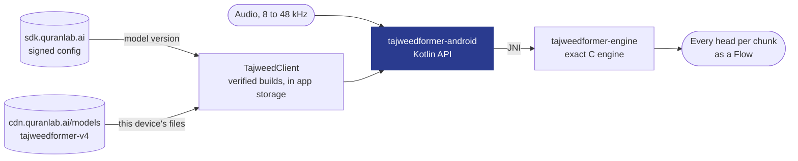

# TajweedFormer for Android: reference for coding assistants

Everything an assistant needs to integrate this SDK correctly: use only the names, calls and settings shown here or in the installed version's sources. People: the short version is in [README.md](README.md).

## What you get

<table>
<tr>
<td width="33%" valign="top">

**Hears the recitation**<br>Streaming recognition of Quranic recitation: audio in, and what the model heard comes out as often as every 160 ms on the CPU engine (320 ms by default, including on the NPU; 480 ms for longer context).

</td>
<td width="33%" valign="top">

**Every output of the model**<br>The sounds it heard with confidence and timing, and every head of the network per chunk (lengthening, gemination, ghunna, qalqalah and more): yours to build on.

</td>
<td width="33%" valign="top">

**Native on Android**<br>Kotlin for Android 8.0+ and the desktop JVM. It runs on the CPU on every phone, and on the NPU where this phone's build passes its self-test.

</td>
</tr>
<tr>
<td valign="top">

**Private by default**<br>Offline, on the device. A recording leaves it only when the learner agrees to share it.

</td>
<td valign="top">

**Nothing to host**<br>The SDK downloads the right model for each device (56.5 MB) from our CDN in six regions, verifies it and keeps it up to date.

</td>
<td valign="top">

**Data for your own judge**<br>The SDK scores nothing. The model's thresholds and the expected units of each ayah come with it as read-only data, so your app can judge a recitation its own way.

</td>
</tr>
</table>

## Why TajweedFormer

- **Made for the Quran.** Trained on Quranic recitation, with its own sound units and heads for what tajweed is about.
- **Feedback in the moment.** Output streams while the learner recites, so your app can respond on the word itself, not after the take.
- **One engine on every platform.** The same engine runs the [Android](https://github.com/Quran-Lab/tajweedformer-android), [iOS and macOS](https://github.com/Quran-Lab/tajweedformer-apple), [web](https://github.com/Quran-Lab/tajweedformer-web) and [Windows and Linux](https://github.com/Quran-Lab/tajweedformer-c) SDKs, all set from one portal.
- **Free, and it stays free.** Quran Lab is a non-profit waqf: the SDKs and models are never sold. The licence, NPL-1.2, asks three things: no paywall on model features, no results presented as rulings, and show the notice.

## Built for AI developers

Copy the setup prompt from [sdk.quranlab.ai](https://sdk.quranlab.ai) and paste it into your coding assistant. That one prompt sets everything up: the package, your key, and the first calls. [AGENTS.md](AGENTS.md), beside this README, gives the assistant the complete API, so the code it writes uses names that exist. Prefer to do it by hand? Get a key in the portal and start below.

## At a glance

- **What it is:** the Kotlin SDK for the Quran Lab TajweedFormer engine (Maven `ai.quranlab:tajweedformer`, one
  package, `ai.quranlab.tajweedformer`). SDK 3.0 is inference only: it downloads and verifies the model, runs it on
  the device and gives the app the model's output. It does not judge a recitation: there is no scorer, no verdict
  and no tajweed setting in it. What an app needs to build its own judge ships as data (the calibration and the
  expected units of every ayah, below).
- **Five things to know:** a `TajweedClient` (the app's key, one per process), a `TajweedModel` (a verified model
  on the device), a `TajweedSession` (one take), the `TajweedHeads` (the model's output) and the `TajweedBackend`
  (the CPU engine or this phone's accelerator). Every failure is one type, `TajweedError`, with a code, what
  happened and what to do about it.
- **Who it is for:** Android apps (AAR; Android 8.0 (API 26) or later; phones and tablets are arm64-v8a and
  armeabi-v7a). `x86_64` is for the Android emulator on an Intel or AMD PC and for x86 Chromebooks: there the SDK
  runs its CPU engine only, never an accelerator. The same Kotlin sources also run on the desktop JVM
  (`TajweedClient(key, storage)`).
- **Coming from 2.x:** 3.0.0 is a breaking release. [docs/migrating-to-3.md](docs/migrating-to-3.md) maps every
  2.x call to its 3.0 name and says what an app that used the verdicts builds itself.

## The TajweedFormer SDKs

One model, one engine, the same bits on every platform. Each SDK compiles the same engine source
(Quran-Lab/tajweedformer-engine, pinned as a submodule), so no platform can drift from the others.

| Repository | What it is | Platforms | Install |
| - | - | - | - |
| [tajweedformer-android](https://github.com/Quran-Lab/tajweedformer-android) | Kotlin SDK (AAR) | Android 8.0+ on arm64-v8a and armeabi-v7a, desktop JVM | Maven Central `ai.quranlab:tajweedformer:3.0.0` |
| [tajweedformer-apple](https://github.com/Quran-Lab/tajweedformer-apple) | Swift SDK: Neural Engine (CoreML) with the exact CPU engine as fallback | iOS 15+, macOS 12+, Apple silicon | SwiftPM, `from: "3.0.0"`, product `TajweedFormer` |
| [tajweedformer-web](https://github.com/Quran-Lab/tajweedformer-web) | WebAssembly SDK with SIMD128 | Browsers, Node 20+ | `npm install @quran-lab/tajweedformer` |
| [tajweedformer-c](https://github.com/Quran-Lab/tajweedformer-c) | C API and server runner with x86 int8 kernels (AVX2, AVX-VNNI, AVX-512 VNNI) | Windows, Linux (x86-64) | CMake `FetchContent`, tag 3.0.0 |
| [tajweedformer-engine](https://github.com/Quran-Lab/tajweedformer-engine) | The engine: exact C runtime, inference library, conformance suite | everything above | Git submodule |

The model is Quran-Lab/tajweedformer-v4 (`sdk/v4.0`), hosted by Quran Lab and served by
`cdn.quranlab.ai/models` to app keys from [sdk.quranlab.ai](https://sdk.quranlab.ai).
SDK 2.x runs V4 only.
[sdk.quranlab.ai](https://sdk.quranlab.ai) is where you create an app, get its developer key,
choose which model revision your users get, and, for SDK 2.x scoring, set the tajweed checks (presets,
per-class thresholds) your users see, without shipping a new build.

## Install

```kotlin
// settings.gradle.kts
dependencyResolutionManagement { repositories { google(); mavenCentral() } }

// app/build.gradle.kts
dependencies { implementation("ai.quranlab:tajweedformer:3.0.0") }
```

## Before you start

| | |
| - | - |
| **Key** | An Android key from [sdk.quranlab.ai](https://sdk.quranlab.ai), for your app's package name. |
| **Devices** | Android 8.0 (API 26) or later. Phones and tablets are `arm64-v8a` and `armeabi-v7a`. `x86_64` is for the Android emulator on an Intel or AMD PC and for x86 Chromebooks: there the SDK runs its CPU engine only, never an accelerator. On another ABI the SDK fails with `runtime_unsupported`. An app that does not ship to Chromebooks keeps `x86_64` out of its release build with one `abiFilters` line. |
| **Permissions** | `RECORD_AUDIO`: the SDK's manifest declares it and `model.listen()` asks for it at run time. The SDK's manifest also brings `INTERNET` and `ACCESS_NETWORK_STATE`; WorkManager, which it uses for background work, brings `WAKE_LOCK`, `RECEIVE_BOOT_COMPLETED` and `FOREGROUND_SERVICE`. |
| **Download** | The first run downloads the model: 56.5 MB, once (73.5 MB on disk), on any network. `client.prefetch()` does it before the learner taps, and `prefetch(unmeteredOnly = true)` waits for Wi-Fi. A phone with a supported NPU fetches its build later, on an unmetered network only. |
| **Sharing** | Recognition needs nothing more. If Quran Lab offers recording sharing to your app, uploads need Play Integrity: add `com.google.android.play:integrity` and put Quran Lab's project number in your manifest. |
| **Build** | Built and tested with JDK 17, Android Gradle Plugin 8.2 and Kotlin 1.9. |
| **Takes** | A Model runs one take (one Session) at a time; a take holds at most 20 minutes of audio. |

## Quick start

```kotlin
suspend fun quickStart(context: Context, heard: TextView) {
    val client = TajweedClient(context, "qlk_v1_...")       // your key from sdk.quranlab.ai; one Client per process
    val model = client.model()                              // the first run downloads and verifies the model
    val session = model.listen(TajweedSessionOptions(endOnSilenceMs = 1500))   // asks for the microphone itself
    session.chunks.collect { chunk -> heard.text = chunk.decoded.text }       // what the model heard so far
}
```

These are the four calls of every Quran Lab SDK: Client, model, listen, read. The code is
[`examples/quickstart`](examples/quickstart)'s `QuickStart.kt`, which CI builds. The app beside it,
[`ExampleActivity.kt`](examples/quickstart/src/main/kotlin/ai/quranlab/tajweedformer/example/ExampleActivity.kt), is
the smallest screen around those calls, in one file: the model loading with its download progress, "Play sample" (a
sample clip, no microphone), "Recite", the tokens as they come (tentative ones dimmed) and "Diagnose". Its
application id is `ai.quranlab.tajweedformer.example`: a key works for the first app that used it, so run the example
with a key made for that identifier ([its README](examples/quickstart/README.md) says how). Nothing else is needed:

- **The microphone.** `model.listen()` asks for `android.permission.RECORD_AUDIO` when it has to (the SDK's manifest
  declares it; a refusal is the error `microphone_denied`), captures at the device's own rate and carries that rate
  to the Session. No sample rate appears in your code.
- **The end of a take.** With `endOnSilenceMs` (500 to 60000) the take finishes by itself after that much silence
  following speech: the last chunk has `decoded.isFinal`, `chunks` completes and `session.finish()` returns the
  take's Heads. Silence is where the model writes nothing, on `log_probs` and on its timing head, so a held sound
  is speech, however long, and does not end the take. In a noisy room a take may not end on silence, so keep a
  Stop button (`session.finish()`; the example has one); the 20 minute limit ends a take in any case. Values under
  1000 can end a take in a breath pause between two words; the quick start uses 1500, and the minimum is 500.
  Without it the take runs until `finish()` or `cancel()`.
- **Background.** A `listen` take ends when the app leaves the foreground (`Ended(BACKGROUND)`); it is not paused.
  Start a new one when the app comes back: the example does it in `onStart` with one line.
- **Your own audio.** `model.session()` and `session.push(samples)` replace `listen()`; everything else is the
  same. `TajweedSessionOptions(sampleRate = ...)` names the rate of what you push (default 16000).

## What the SDK gives

One take gives chunks while it runs and the take's Heads when it ends. A chunk (`TajweedChunk`, every 320 ms at the
default context) carries:

- **The heads** (`chunk.heads`, `TajweedHeads`): every selected head of the network as float32, `[frames, classes]`
  row major (`TajweedHead.values`, with `name`, `kind`, `frameMs`, `frames`, `classes`, `classNames`). The CTC heads
  (`log_probs`, `inter1_log_probs`, `timing_log_probs`) are log-probabilities over the model's tokens; the attribute
  heads (`gem`, `attr_*`) are probabilities; `boundary` and `conf` are logits. `TajweedSessionOptions(heads = ...)`
  selects them by name; the default is the three CTC heads, `gem`, `attr_qalqalah` and `conf`.
  `heads.greedy(name)` is the greedy reading of a CTC head.
- **The decoded layer** (`chunk.decoded`, `TajweedDecoded`): what the model heard in the take so far. `tokens`
  (each with `id`, `name`, `firstMs`, `peakMs`, `lastMs`, `confidence`), `words` (split at the word bar), `text`,
  and per 40 ms frame the top token, its log-probability, the runner-up and the margin (`frames`; with
  `topK = n` also the n best). **Settled and tentative:** the first `settled` tokens will not change any more (their
  run of frames has ended); the ones after them may still grow or be replaced by the next chunk. On the last chunk
  `isFinal` is true and every token is settled. Draw settled tokens once and redraw only the tail.
- **Speech** (`chunk.speech`): whether the model heard speech in this chunk, from its own output, not from the
  signal's level.

Events come beside the chunks (`session.events`, a `Flow<TajweedEvent>`):

| Event | When | The take |
| - | - | - |
| `SpeechStarted(atMs)` | The first sound of a stretch of speech | Goes on |
| `SpeechEnded(atMs, silenceMs)` | Silence after speech: 1500 ms, or `endOnSilenceMs` when that is set | Goes on; with `endOnSilenceMs` it finishes here |
| `Interrupted(cause)` | `listen` only. `INTERRUPTION`: a call, or another app took the audio. `ROUTE_CHANGE`: headphones in or out | Paused until `Resumed`, or goes on (route change) |
| `Resumed` | The interruption is over | Goes on |
| `BackendChanged(backend, fromChunk)` | The take moved from the accelerator to the CPU. Chunks from `fromChunk` on are delivered again and replace the ones the app has | Goes on |
| `Ended(reason, error)` | The take ended without the app's `finish()`: `SILENCE`, `BACKGROUND`, `INTERRUPTED`, `SOURCE_END`, `ERROR` | Finished: `finish()` returns its Heads |

`session.finish()` returns the take's `TajweedHeads`: every selected head over the whole take and its final decoded
layer (`heads.decoded()`). `session.cancel()` ends the take and keeps nothing. A Model has one open Session at a
time (`session_open` otherwise).

## Calibration and reference data

The SDK ships two things for an app that judges a recitation itself. Both are data: signed, verified, read-only,
and never applied or read by the SDK.

**The calibration** (`model.calibration`, null when the build has none): `calibration.json` exactly as shipped
(`json`, `sha256`, format `quranlab.tajweed-calibration/1`), with accessors for the common lookups and
`value("contexts", ctx, ...)` for the rest. What it holds:

- `model_id`, `checkpoint_sha256`, `tokens_sha256` (the vocabulary it belongs to), `default_context`,
  `default_preset`, the `classes` of mistakes (`vowel_sub`, `vowel_del`, `vowel_ins`, `short_to_long`,
  `long_to_short`, `cons_sub`, `cons_del`, `insertion`), the `presets` (`strict`, `balanced`, `sensitive`,
  `very_sensitive`, each with its target false-alarm rate) and `readout` (how the numbers were made).
- `contexts.<ctx>.fusion`: the heads the site thresholds apply to (`log_probs`, `inter1_log_probs`), the weight `a`
  per class (`llr = a * llr(log_probs) + (1 - a) * llr(inter1_log_probs)`, `calibration.fusionWeight(ctx, class)`),
  the `inter1_prep` rule (the word bar merged into blank) and the clip of the LLRs ([-30, 30]).
- `contexts.<ctx>.sites.<class>.thresholds.<preset>` (`calibration.threshold(ctx, class, preset)`): a threshold in
  nats on the fused LLR = log P(best single-unit alternative) - log P(expected sequence), by the full-sequence CTC
  forward on the take's heads. A site is flagged when its LLR is above the threshold. `status(ctx, class)` is
  `validated`, `experimental` or `off`.
- `contexts.<ctx>.madd` (counts from `timing_log_probs`: the ratio of a long vowel's held span to the median
  short-vowel span, `cuts` per madd class), `qalqalah` (`tau` on the mean of `attr_qalqalah[:,1] + [:,2]` over 12
  frames after the letter's end), `gemination` (`tau` on the mean of `gem[:,1]` over the letter's span), `ghunna`,
  `tafkheem` and `word` (the word readout).

**The reference data** (`model.reference`, null when the build has none): the expected units of every ayah, the
sequence a correct recitation of that ayah gives. It is not part of the first download. `reference.fetch()`
downloads and verifies it once (`isDownloaded`), and `reference.units(surah, ayah)` then returns the ayah's unit
ids with the word bar (`model.tokens.wordBar`) between words; `model.tokens.name(id)` names them. An ayah that does
not exist is the error `invalid_app_option`; a lookup before the fetch is `reference_missing`.

With the heads, the tokens, the expected units and the calibration an app has everything the 2.x scorer read. The
alignment and the LLR are the app's: [docs/migrating-to-3.md](docs/migrating-to-3.md) describes them.

## Usage

### The Client and the model

`TajweedClient(context, key)` makes the one Client of the process (a second one while the first is not closed is the
error `client_exists`). Options are always last and optional:
`TajweedClientOptions(appVersion, storage, analytics, audience)`.

- `client.model()` gives the model version Quran Lab's signed config recommends for this app, downloading and
  verifying it on the first call; `client.model("4.0.0")` asks for one version. A model has a `version` (what you
  ask for) and a `build` (the exact files, 40 hex); `model.contexts`, `defaultContext` and `chunkMs(context)` say
  which response times it has. The context of a take is the app's (`TajweedSessionOptions(context = ...)`), else
  the one set for the app at sdk.quranlab.ai, else the model's default.
- `client.prefetch(unmeteredOnly, onProgress)` downloads the model before the learner taps, so the first take does
  not wait. With `unmeteredOnly = true` it waits while the connection is metered or absent (the call returns; call
  it again later, for example at the next app start) and downloads on Wi-Fi or Ethernet. On the desktop JVM the
  SDK cannot tell what the connection is, so the option cannot be honoured there and the download runs.
  `client.storage` says what is on the device, `client.removeModels()` deletes it.
- `client.diagnose()` answers "why does it not work" in one object (`toJson()` for a bug report): the SDK version
  and the newest one, whether the key was accepted and why not, whether the config is fresh, the model on the
  device and whether it verified, the context, the backend and its stage, the microphone permission, storage, the
  last error, the chunks dropped for a collector that did not read, and the connection (`unmetered`, `metered`,
  `none`, or `unknown` on the desktop JVM). It never throws and works offline.
- `TajweedModel.open(folder)` opens a verified model folder the app ships or keeps itself, with no Client.

### Without a microphone

A model folder carries a few short real recitations, its self-test clips (`model.sampleClips`: `name`, `kind`,
`durationMs`). `model.listen(clip)` runs one through the same path as the microphone, and
`model.listen(samples, sampleRate)` does it for audio the app already has; `pace = Pace.REAL_TIME` (the default)
plays it at the speed it was recorded, `Pace.FAST` as fast as the engine takes it. The take ends with
`Ended(SOURCE_END)`. This is how an example, a test or an emulator shows real output with no microphone.

### Errors

Every failure is a `TajweedError` with a `code` from one list shared by every Quran Lab SDK, a `message`, a `fix`
and a `docs` link (`https://sdk.quranlab.ai/docs/errors#<code>`): `invalid_key`, `needs_connection`,
`model_unavailable`, `sdk_too_old`, `storage_full`, `microphone_denied`, `session_open`, `cancelled`,
`runtime_unsupported` (a device the SDK has no native library for), `network_not_permitted` (the app's manifest
lost the INTERNET permission the SDK declares) and the rest, 26 in all. When Quran Lab's server refuses the app
(`server_rejected`), the message says which refusal it was and the fix says what to do about that one.
Catch the one type and show or log the message and the fix.

### Model download and verification

The model comes from Quran Lab's CDN. The SDK fetches the build's signed `manifest.json` (Ed25519, checked against
Quran Lab's key), and downloads only the files this device needs: the CPU set of the context in use (the shared
weights, the front end, the tokens, the calibration, and the context's graph, data and frames), later the files of
this phone's accelerator build when there is one, and the reference data only when the app asks. Downloads resume
(HTTP Range, If-Range with the server's ETag); every file's size and SHA-256 are checked as stored and as decoded,
then moved into place atomically; any mismatch deletes it. Models are kept by build under
`<storage>/models/<model id>/<build>/`, so a new version never overwrites the one in use, and an app that goes
offline keeps working with the last verified build.

### CPU first, then the accelerator

The first take runs on the exact CPU engine, on every phone, and nothing else is downloaded or compiled before it.
On a phone whose chip has an accelerator build (Google Tensor G3 to G5, Exynos 2500 and 2600, through LiteRT, which
the app adds: `com.google.ai.edge.litert:litert:2.2.0` and the vendor dispatch library), the SDK prepares it in the
background after the first take: download on an unmetered network, load, warm-up, then the golden test. `model.backend`
and `session.backend` say where it stands (`TajweedBackend`: `kind`, `name`, `stage` `CPU`, `DOWNLOADING`,
`COMPILING`, `TESTING`, `PROMOTED` or `DEMOTED`, and the `reason` when it stays on the CPU). Nothing is needed from
the app.

- **The golden test compares raw outputs.** The model's five self-test clips run through the accelerator and
  through the CPU engine in the same run. The CPU must give the shipped tokens exactly. The accelerator is judged
  against the tolerance the model build signs for it (`golden_raw_tolerance`): per CTC head the token edits over
  the clean clips and the mean and the 99th percentile of the largest per-frame difference of the
  log-probabilities; for the attribute heads the mean difference of the probabilities. An fp16 accelerator build
  is nearer the fp32 model than the int8 CPU engine is, so a tolerance may allow token edits. A build the manifest
  signs no tolerance for must give the CPU's tokens exactly. A build that passes is promoted whatever its speed; a
  build that fails stays off for this model build and OS build.
- **The swap happens only at the start of a take**, to an accelerator that is already loaded and warm.
- **During a take** every accelerator call runs against a time limit. A call that throws, returns NaN or values the
  build cannot produce, or is late, is abandoned: the last 5.12 s of audio are replayed through the CPU engine and
  the take goes on there (`BackendChanged`). A long silence from the accelerator is checked against the CPU engine
  in the background before anything is switched.
- Preparation runs only while no take is active, not in battery saver, not below 20 % battery unless charging, and
  not above light thermal throttling. It is WorkManager work, so it resumes after the app is killed or the phone
  restarts.

The accelerator path has not run inside an app on an accelerator phone yet; its native runner ran on the Exynos
2500 and 2600 boards.

### Recitation sharing

Quran Lab decides per app, in the signed config, whether the SDK offers sharing; without a signed config in force
nothing is offered. Offered is never consent: nothing is recorded for sharing and nothing is sent before the
learner taps "Share" on the consent sheet, and a learner who never answers never shares. While the learner agreed,
each recitation the SDK listens to is uploaded in the background as Opus in one Ogg stream, from a queue on disk
that survives process death and reboots.

- `client.sharing` (`TajweedSharing`): `isAvailable`, `isOn`, `setOn(false)` (stops uploads at once and deletes the
  unsent queue), `ask()` (shows the sheet at the app's moment; it counts as one of the three showings an install
  ever gets), `items`, `summary()`, `delete()` (deletes what this install shared), `recoveryCode`, and
  `setWording(...)` for an app that words the sheet itself.
- The SDK shows its own sheet after a finished take, in the learner's language, with a guardian variant for
  `TajweedClientOptions(audience = Audience.CHILDREN)`. `SharingTheme` styles it; `SharingSettingsView(activity,
  client)` is the settings rows (the switch, "What is shared", "Delete what I shared", the recovery code). In
  Compose: `SharingSheetHost(client)` and `SharingSettings(client)` from `ai.quranlab:tajweedformer-compose`.
- **Recordings that do not cut speech.** A `listen` take records only between `listen()` and the end of the take.
  An app that pushes its own audio can also feed the sharing recording directly (`client.sharing.feed(samples,
  sampleRate)`) so that a recording keeps the half second before a take starts and the half second after it ends;
  the SDK keeps at most one second of fed audio in memory, only while sharing is on, and drops it when the app
  goes to the background, when sharing goes off and on delete.
- Uploads need Play Integrity on Android: add `com.google.android.play:integrity` and put Quran Lab's project
  number in the manifest (`<meta-data android:name="ai.quranlab.tajweedformer.PLAY_INTEGRITY_PROJECT"
  android:value="..."/>`).

### Telemetry

On by default and anonymous by construction: sums and histograms per UTC day, no audio, no recognised text, no
device, user, install or advertising identifier. Off with `TajweedClientOptions(analytics = Analytics.OFF)` or by
Quran Lab's signed config. What the SDK counts per model version, build, context and backend: takes, seconds of
audio, of speech and of silence, tokens per head, compute seconds, and what the accelerator pipeline did. Two calls
let the app add its own counts, for its statistics at sdk.quranlab.ai (nothing is sent if the app never calls
them):

```kotlin
session.reportRecited(surah = 1, ayahFrom = 2, ayahTo = 2)          // after a take: what the learner recited
client.analytics.reportChecks("vowel_sub", checked = 31, flagged = 1)   // what the app's own judge checked and flagged
```

What is sent, when, and what an app can change is the same in every SDK:
[docs/platform-client.md](docs/platform-client.md).

### Data safety (Google Play)

What an app that uses the SDK sends to Quran Lab, for the app's data-safety form. The SDK sends nothing else.

| Data | Play category | Collected | Optional | Linked to the user | Purpose |
| - | - | - | - | - | - |
| Usage statistics: daily sums and histograms (takes, seconds, model version, backend, device class, chip, OS major, RAM tier, the app's own reported counts) | App activity, App info and performance (diagnostics) | Yes, unless the app turns analytics off | The app decides (`Analytics.OFF`); no prompt is needed | No: no identifier of the device, the install or the user; no time finer than the day | Analytics |
| Issue reports: an error's kind and code, SDK and app version, OS version, device model and chip for accelerator incidents | App info and performance (diagnostics, crash logs) | Yes, when a failure happens | No | No | Diagnostics |
| Recitation audio (voice recordings) with the take's sample rate, input route, model version and backend | Audio (voice or sound recordings) | Only after the learner agrees on the consent sheet | Yes: the learner can decline, stop and delete at any time | A random contributor id made for sharing, of which Quran Lab stores only a keyed hash; no account, name or contact | Improving Quran Lab's models |
| Play Integrity verdict | App info and performance (other) | Only while sharing is on | With sharing | No | Fraud prevention (uploads come from a genuine install) |

Everything is sent over HTTPS. No data is sold, and none is passed on to anyone else. Location, contacts, messages,
photos, files and advertising ids are never read. A learner deletes what they shared in the app (`SharingSettingsView`)
or with the recovery code.

### Emulators and the x86_64 library

The AAR carries three ABIs. `arm64-v8a` and `armeabi-v7a` are the phones and tablets. The third is for two kinds
of machine and nothing else: the Android emulator on an Intel or AMD PC, and x86 Chromebooks. On both the SDK runs
its CPU engine only, never an accelerator: an x86 process is given no accelerator build, whatever the device says
its chip is, and `model.backend` stays the CPU.

The x86_64 library is the same exact engine: the 35 conformance clips are bit-exact on it through the library, all
12 outputs of every chunk (`scripts/emulator_proof.py` runs that on an x86_64 emulator). With the model's sample
clips an emulator shows real output with no microphone (`model.listen(clip)`). No phone has this ABI: an app that
does not ship to Chromebooks keeps it out of its release build with one line,

```kotlin
android { buildTypes { release { ndk { abiFilters += listOf("arm64-v8a", "armeabi-v7a") } } } }
```

On any other ABI (32-bit x86, RISC-V) the SDK has no native library: `client.model()` fails with
`runtime_unsupported`, whose fix names where the SDK runs. On a PC without an emulator the same Kotlin sources run
on the desktop JVM (`TajweedClient(key, storage)`).

### Bounds

A take holds at most 20 minutes of audio: at the limit it ends by itself (`Ended(LIMIT)`) with its Heads kept for
`finish()`, and a `push` after it is `session_closed`. `chunks` and `events` keep at most 256 chunks and 64 events
for a collector that is late and drop the oldest; the last chunk and `Ended` are never the ones dropped, every
chunk has the whole take decoded, and `finish()` returns every Head. `client.diagnose()` counts dropped chunks.

## How it works



Each Model owns one thread; every engine call it makes runs there, in order. Audio goes to the engine unchanged
through `native/tj_jni.c`, and the engine resamples, computes the fbank and runs the model one chunk at a time. The
public calls are safe from any thread or coroutine.

<!-- exactness:begin -->
## Exactness

Bit-exact means the same thing in every Quran Lab TajweedFormer repository. For the same input, the
engine gives the same tokens and the same value, to the last bit, for every output of every chunk, on
every device. It is checked on the 35 parity clips of the conformance set: the tokens, the chunk count
and an FNV-1a fingerprint of every chunk's outputs are compared with the expected files, and one bit of
difference on one clip is a failure. Paths that cannot meet this (the Neural Engine, NPUs, fp16
anywhere) are called approximate, and they are measured against the exact engine, never the other way
round.
<!-- exactness:end -->

### How this repository proves it

The wrapper adds nothing that could move a bit: it builds the engine in its release configuration, passes samples
through unchanged, and resamples with the engine's own resampler. `V4ConformanceTest` streams the 35 parity clips'
16 kHz audio through the SDK in 320, 1234, 16000 and 4321-sample pieces and compares the chunk count, the greedy
tokens, the cumulative FNV-1a of `log_probs` and the FNV-1a of all 12 outputs of every chunk with the engine's
expected file. The 1.x and 2.x history is in docs/engineering-notes.md.

The JVM's verifier does not have Android's rule about monitors, so unit tests cannot see a class that every phone
refuses to load: `scripts/check_monitor_handlers.py` applies that rule to every class of the AAR, in CI and before
every upload, and is what stands between a change and a crash at launch on every phone.

## Build from source

The build needs the Android SDK with `platforms;android-34`, `build-tools;34.0.0`, `ndk;30.0.16248370` and
`cmake;3.31.6`, and a JDK 17 or newer. `local.properties` names the SDK (`sdk.dir=/path/to/android-sdk`). With the
command line tools only:

```sh
sdkmanager --licenses
sdkmanager "platform-tools" "platforms;android-34" "build-tools;34.0.0" "ndk;30.0.16248370" "cmake;3.31.6"
./gradlew :tajweedformer:assembleRelease
./gradlew :examples:quickstart:assembleDebug      # the example app
```

`scripts/build_host.sh` builds the JNI library for the desktop JVM (Linux, macOS; Windows under Git Bash with MinGW
GCC, CMake and Ninja on `PATH`).

## Verify it yourself

```sh
scripts/opus/build_opus_host.sh                        # libopus for the sharing tests (once)
./gradlew :tajweedformer-jvm:test                      # desktop JVM, host build of the JNI library
./gradlew :tajweedformer-jvm:test -PnoNative           # no host build (default on Windows); engine tests skip
./gradlew :tajweedformer:assembleDebugAndroidTest      # the device test APK (DeviceEndToEndTest)
```

The proof that needs a model, the 35 conformance clips bit-exact through `model.session()` and every sample clip
through `model.listen(clip)`:

```sh
./gradlew :tajweedformer-jvm:localProof -Pnative -PproofModel=<a decoded 3.0 model folder> -PproofClips=<the folder of .pcm clips>
```

It prints the clips, chunks and values compared, the mismatches, the wall time and the peak memory, and skips
when the folders are not there.

Most tests need no engine: manifests, signatures, versions and builds, downloads against a local Range / ETag
server, the Client against a stub of Quran Lab's server, speech and settled tokens, the raw golden test, telemetry,
sharing, and the shared vectors of SDK 3.0 (`src/test/resources/vectors30`, the same files every SDK tests against).
With the host library (`TAJWEEDFORMER_LIBRARY`) and a model folder, the engine tests run too: `TJ_V4_DIR` (a decoded
model folder), `ZF_V4_AUDIO_DIR` and `ZF_V4_CONFORMANCE_DIR` (the engine's clips and expected files) for
`V4ConformanceTest`; `TJ_SELFTEST_MODEL` and `TJ_FAILOVER_MODEL` for the self-test and failover tests with the real
engine. A folder signed with a test key is trusted through `TJ_TEST_PUBLIC_KEY` (the test seam; no key but Quran
Lab's is compiled in).

The sharing tests encode real Ogg Opus, so they need the host build of `libtajweedformer_opus` (libopus 1.6.1,
vendored). Without it they are skipped; `TJ_REQUIRE_OPUS=1` makes a missing library a failure, and CI sets it.

## Layout

```
native/                     tj_jni.c over the engine's inference API and front end; litert_npu.c (NPU runner)
tajweedformer/              the Android library (AAR), ai.quranlab:tajweedformer
  src/main/kotlin           the API, plain JVM Kotlin: the same sources on Android and the JVM
  src/main/resources        the error catalogue, the sharing copy decks
  src/android/kotlin        Android only: the Client's platform side, the microphone, the sharing views
  src/jvm/kotlin            desktop JVM only: TajweedClient(key, storage)
  src/androidTest           DeviceEndToEndTest
tajweedformer-compose/      the sharing sheets and settings in Jetpack Compose (optional)
tajweedformer-jvm/          those sources on the desktop JVM, with the tests
examples/quickstart/        the example app, one screen: loading, Play sample, Recite, the tokens, Diagnose
docs/                       migrating-to-3.md, api.md, platform-client.md
scripts/                    host builds, the device test's server, the emulator proof, the phone gate, the monitor
                            check, the API page's generator
engine/                     tajweedformer-engine, pinned
```

## Status

3.0.0 is inference only: the scorer, the tajweed settings and the verdict types of 2.x are gone, and the
public API is the five concepts above with the same names on every platform ([docs/api.md](docs/api.md) lists it).
See [CHANGELOG.md](CHANGELOG.md).

What is proven where: the shared vectors of SDK 3.0, the Client against a stub server and the sharing rules run on
every push in CI without a model; the engine through JNI builds and runs there too. No public runner has a model,
so the 35 conformance clips and the sample clips through the public API are run where a model folder is at hand
(`./gradlew :tajweedformer-jvm:localProof`, see "Verify it yourself"), and the device test ran on an x86_64
emulator (`scripts/emulator_proof.py`). The release gate is `scripts/phone_gate.py`: the example app, built against
the AAR as a file, on an attached phone with a development key; it must start, download and verify the model, give
the model build's expected tokens on every sample clip, and leave `diagnose()` and the phone's own verifier with
nothing to say. Not run yet with 3.0: the 35 conformance clips on a phone, and an accelerator inside an app.

## Download size

The SDK downloads only its device's profile of the model folder (`sdk/v4.0`, manifest format 3), gzip on the
wire, resumable, every file checked against the signed manifest. Sizes are those of model revision
v4.0-2026-11-10, default context `c16_l64`:

| Profile | What is downloaded | Size |
| - | - | - |
| Any Android phone (CPU, always, first) | tokens, calibration, expected table, the shared `layers.zfw` and `frontend.zfw`, the c16_l64 graph and its frames | **56.5 MB** (73.5 MB on disk) |
| + Exynos 2500 NPU (later, unmetered network) | `npu/exynos2500/c16_l64` (9 chained parts) | +18.8 MB as a delta against the CPU weights, else +61.4 MB |
| + Exynos 2600 NPU (later, unmetered network) | `npu/exynos2600/c16_l64` | +18.1 MB as a delta, else +61.7 MB |
| + Google Tensor G3, G4, G5 NPU (later, unmetered network) | `npu/tensor_gN/c16_l64` | +84.6, 84.6, 86.0 MB as a delta, else +120.8, 120.8, 121.0 MB |
| Another context later (CPU) | that context's graph and frames | +0.65 to 0.86 MB each |

NPU builds ship only for chips checked on real hardware, and only for the default context `c16_l64`; every
other phone and context runs the CPU engine, which is always there: any NPU load or self-test failure falls
back to it.

## Problems and wishes

Something does not work, something is missing, or you want to tell us how it went:
[open an issue](https://github.com/Quran-Lab/tajweedformer-android/issues/new/choose). There is a form for a bug, one for a
wish and one for a word of feedback. Issues are public, so leave out keys and anything that came from a learner.
A security problem does not go into an issue: use "Report a vulnerability" on the
[Security tab](https://github.com/Quran-Lab/tajweedformer-android/security). A coding assistant can file an issue for you; it
shows you the text first.

## Licence

Quran Lab is a waqf: the SDKs and the models are free to use and are never sold.

The source code in this repository and the TajweedFormer model weights are released under the
Quran-Lab No-Profit License 1.2 ([NPL-1.2](LICENSE)): use, copy, modify and build on them freely,
but never charge for them, for access to them, or for any feature they power. The weights are not
stored in this repository; Quran Lab hosts them itself and serves them to apps by
`cdn.quranlab.ai/models` under the same licence. Get access at
[sdk.quranlab.ai](https://sdk.quranlab.ai).

Third-party components keep their own licences, listed in their folders under `third_party/`.
