<p align="center">
  <picture>
    <source media="(prefers-color-scheme: dark)" srcset=".github/assets/quranlab-mark-dark.svg">
    <source media="(prefers-color-scheme: light)" srcset=".github/assets/quranlab-mark-light.svg">
    
  </picture>
</p>

<h1 align="center"><picture><source media="(prefers-color-scheme: dark)" srcset="docs/banner-dark.svg"></picture></h1>

<p align="center">TajweedFormer V4 for Android: recitation audio in, the model's output out while the learner recites. On the device, offline, and free.</p>

<p align="center">
  
  
  
  
</p>

## What you get

<table>
<tr>
<td width="33%" valign="top">

**Hears the recitation**<br>Streaming recognition of Quranic recitation: audio in, and what the model heard comes out as often as every 160 ms on the CPU engine (320 ms by default, including on the NPU; 480 ms for longer context).

</td>
<td width="33%" valign="top">

**Every output of the model**<br>The sounds it heard with confidence and timing, and every head of the network per chunk (lengthening, gemination, ghunna, qalqalah and more): yours to build on.

</td>
<td width="33%" valign="top">

**Native on Android**<br>Kotlin for Android 8.0+ and the desktop JVM. It runs on the CPU on every phone, and on the NPU where this phone's build passes its self-test.

</td>
</tr>
<tr>
<td valign="top">

**Private by default**<br>Offline, on the device. A recording leaves it only when the learner agrees to share it.

</td>
<td valign="top">

**Nothing to host**<br>The SDK downloads the right model for each device (55.5 MB) from our CDN in six regions, verifies it and keeps it up to date.

</td>
<td valign="top">

**Data for your own judge**<br>The SDK scores nothing. The model's thresholds come with it as read-only data, so your app can judge a recitation its own way. The expected units of each ayah do not: with this release and the model build served now, `model.reference` is null.

</td>
</tr>
</table>

## Why TajweedFormer

- **Made for the Quran.** Trained on Quranic recitation, with its own sound units and heads for what tajweed is about.
- **Feedback in the moment.** Output streams while the learner recites, so your app can respond on the word itself, not after the take.
- **One engine on every platform.** The same engine runs the [Android](https://github.com/Quran-Lab/tajweedformer-android), [iOS and macOS](https://github.com/Quran-Lab/tajweedformer-apple), [web](https://github.com/Quran-Lab/tajweedformer-web) and [Windows and Linux](https://github.com/Quran-Lab/tajweedformer-c) SDKs, all set from one portal.
- **Free, and it stays free.** Quran Lab is a non-profit waqf: the SDKs and models are never sold. The licence, NPL-1.2, asks three things: no paywall on model features, no results presented as rulings, and show the notice.

## Built for AI developers

Copy the setup prompt from [sdk.quranlab.ai](https://sdk.quranlab.ai) and paste it into your coding assistant. That one prompt sets everything up: the package, your key, and the first calls. [AGENTS.md](AGENTS.md), beside this README, gives the assistant the complete API, so the code it writes uses names that exist. Prefer to do it by hand? Get a key in the portal and start below.

## Install

```kotlin
// settings.gradle.kts
dependencyResolutionManagement { repositories { google(); mavenCentral() } }

// app/build.gradle.kts
dependencies { implementation("ai.quranlab:tajweedformer:3.1.5") }
```

## Before you start

| | |
| - | - |
| **Key** | An Android key from [sdk.quranlab.ai](https://sdk.quranlab.ai), for your app's package name. |
| **Devices** | Android 8.0 (API 26) or later. Phones and tablets are `arm64-v8a` and `armeabi-v7a`. `x86_64` is for the Android emulator on an Intel or AMD PC and for x86 Chromebooks: there the SDK runs its CPU engine only, never an accelerator. On another ABI the SDK fails with `runtime_unsupported`. An app that does not ship to Chromebooks keeps `x86_64` out of its release build with one `abiFilters` line. |
| **Permissions** | `RECORD_AUDIO`: the SDK's manifest declares it and `model.listen()` asks for it at run time. The SDK's manifest also brings `INTERNET` and `ACCESS_NETWORK_STATE`; WorkManager, which it uses for background work, brings `WAKE_LOCK`, `RECEIVE_BOOT_COMPLETED` and `FOREGROUND_SERVICE`. |
| **Download** | The first `client.model()` or `client.prefetch()` downloads the model: 55.5 MB, once (68.1 MB on disk), on any network. `client.prefetch()` does it before the learner taps, and `prefetch(unmeteredOnly = true)` waits for Wi-Fi. A phone with a supported NPU fetches its build later, on an unmetered network only. |
| **Model** | A model comes only from Quran Lab's server, through the Client: the SDK opens only a model it downloaded itself on this device. An app that updates from an SDK before 3.1.0 downloads the model once more. |
| **Play Integrity** | Since 3.1.0 the SDK depends on Google's Play Integrity library (`com.google.android.play:integrity`; with the ten libraries it brings it adds 33,594 bytes to the example app's release APK shrunk with R8, and 34,420 bytes to its debug APK). Quran Lab can ask for proof that a model download or a shared recording comes from your app as Google Play delivered it, on a real device; the SDK asks Play only when Quran Lab's signed config says so, and continues without it where Play services are missing. You add and set nothing. |
| **Build** | Built and tested with JDK 17, Android Gradle Plugin 8.2 and Kotlin 1.9. |
| **Takes** | A Model runs one take (one Session) at a time; a take holds at most 20 minutes of audio. |

## Quick start

```kotlin
suspend fun quickStart(context: Context, heard: TextView) {
    val client = TajweedClient(context, "qlk_v1_...")       // your key from sdk.quranlab.ai; one Client per process
    val model = client.model()                              // the first call downloads and verifies the model
    val session = model.listen(TajweedSessionOptions(endOnSilenceMs = 1500))   // asks for the microphone itself
    session.chunks.collect { chunk -> heard.text = chunk.decoded.text }       // what the model heard so far
}
```

These are the four calls of every Quran Lab SDK: Client, model, listen, read. The code is
[`examples/quickstart`](examples/quickstart)'s `QuickStart.kt`, which CI builds. The app beside it,
[`ExampleActivity.kt`](examples/quickstart/src/main/kotlin/ai/quranlab/tajweedformer/example/ExampleActivity.kt), is
the smallest screen around those calls, in one file: the model loading with its download progress, "Play sample" (a
sample clip, no microphone), "Recite", the tokens as they come (tentative ones dimmed) and "Diagnose". Its
application id is `ai.quranlab.tajweedformer.example`: a key works for the first app that used it, so run the example
with a key made for that identifier ([its README](examples/quickstart/README.md) says how). Nothing else is needed:

- **The microphone.** `model.listen()` asks for `android.permission.RECORD_AUDIO` when it has to (the SDK's manifest
  declares it; a refusal is the error `microphone_denied`), captures at the device's own rate and carries that rate
  to the Session. No sample rate appears in your code.
- **The end of a take.** With `endOnSilenceMs` (500 to 60000) the take finishes by itself after that much silence
  following speech: the last chunk has `decoded.isFinal`, `chunks` completes and `session.finish()` returns the
  take's Heads. Silence is where the model writes nothing, on `log_probs` and on its timing head, so a held sound
  is speech, however long, and does not end the take. In a noisy room a take may not end on silence, so keep a
  Stop button (`session.finish()`; the example has one); the 20 minute limit ends a take in any case. Values under
  1000 can end a take in a breath pause between two words; the quick start uses 1500, and the minimum is 500.
  Without it the take runs until `finish()` or `cancel()`.
- **Background.** A `listen` take ends when the app leaves the foreground (`Ended(BACKGROUND)`); it is not paused.
  Start a new one when the app comes back: the example does it in `onStart` with one line.
- **Your own audio.** `model.session()` and `session.push(samples)` replace `listen()`; everything else is the
  same. `TajweedSessionOptions(sampleRate = ...)` names the rate of what you push (default 16000).

## More

The full reference (every layer of the API, backends, what a device downloads, platform settings, recording sharing, building and testing) is in [AGENTS.md](AGENTS.md), written for coding assistants and just as readable for you. Guides: [sdk.quranlab.ai/docs](https://sdk.quranlab.ai/docs).

## Problems and wishes

Something does not work, something is missing, or you want to tell us how it went:
[open an issue](https://github.com/Quran-Lab/tajweedformer-android/issues/new/choose). There is a form for a bug, one for a
wish and one for a word of feedback. Issues are public, so leave out keys and anything that came from a learner.
A security problem does not go into an issue: use "Report a vulnerability" on the
[Security tab](https://github.com/Quran-Lab/tajweedformer-android/security). A coding assistant can file an issue for you; it
shows you the text first.

## Licence

Quran Lab is a waqf: the SDKs and the models are free to use and are never sold.

The source code in this repository and the TajweedFormer model weights are released under the
Quran-Lab No-Profit License 1.2 ([NPL-1.2](LICENSE)): use, copy, modify and build on them freely,
but never charge for them, for access to them, or for any feature they power. The weights are not
stored in this repository; Quran Lab hosts them itself and serves them to apps by
`cdn.quranlab.ai/models` under the same licence. Get access at
[sdk.quranlab.ai](https://sdk.quranlab.ai).

Third-party components keep their own licences, listed in their folders under `third_party/`.
